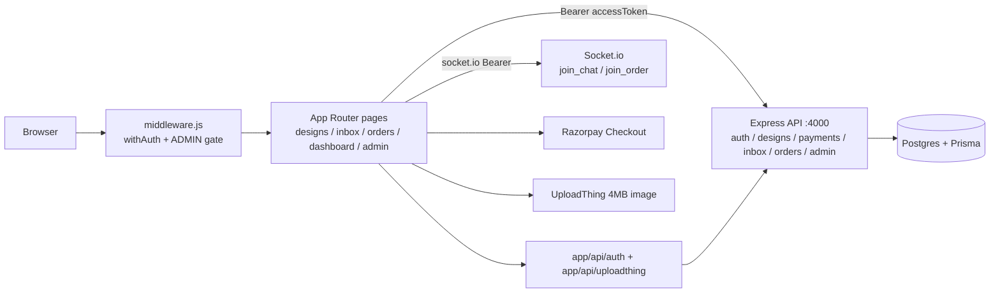

# StytchUp Web — Next.js Marketplace Frontend

I built the storefront for StytchUp, a marketplace for made-to-order and custom designer fashion. It handles auth, catalog, chat negotiation, Razorpay checkout, and live order tracking against an Express + Postgres API.


## Key highlights

- NextAuth BFF: credentials login proxies `POST /auth/login`, Google login syncs via `POST /auth/google-sync` and overwrites `sub` with the Postgres ID (`app/api/auth/[...nextauth]/route.js:69-95`).
- Edge + client role gates: `middleware.js` protects 5 route groups and requires `ADMIN` for `/admin/*`; `app/admin/page.jsx:60-67` redirects non-admins again.
- Realtime without reloads: `join_chat` / `new_message` / `offer_created` / `offer_accepted` in chat, `join_order` / `order_updated` on both dashboards (`utils/useOrderSocket.js:19-27`).
- Safe payments: client sends only `{ sourceId, type }` — amount is derived server-side in paise (`components/checkout/RazorpayButton.jsx:28-34`).
- 15 `node:test` suites, zero test deps; CI runs `lint → test → build → docker build` (`.github/workflows/ci.yml`).

## Demo


> Placeholder — `docs/demo.gif` does not exist yet.

Record (60s, 2 windows side by side):

1. Window 1: `/` → `/designs` → `/designs/:id` → Order Now → Razorpay test checkout → `/orders`.
2. Window 2 (designer): `/dashboard` shows the new order live via `order_updated`, no refresh.
3. Window 1: chat at `/inbox/:id` → create offer (₹ button) → Window 2 accepts → `offer_accepted` flips the card.
4. Window 1: `/orders/:id/submit-requirements` → submit chest/waist/hips → status flips to `IN_PROGRESS` in both windows.

Screenshot fallback: `/designs/:id` with price + Order Now button, and `/inbox/:id` with an offer card.

## Architecture

Next.js App Router renders pages and guards routes at the edge. Auth and uploads go through `app/api/*` handlers; data and sockets go direct to Express `:4000`.



## Features

- **Auth:** credentials + Google (NextAuth JWT strategy), role switch customer ↔ designer from user menu (`components/head/usermenu.jsx:66-95`).
- **Catalog:** `/designs`, `/designs/:id`, `/designer`, `/designer/:id`; `next/image` remote patterns for `utfs.io`, Unsplash, ui-avatars (`next.config.mjs:5-30`).
- **Checkout:** `RazorpayButton` create → popup (`#FFC629` theme) → verify → redirect `/orders`.
- **Chat/offers:** 1:1 conversations, text + `{ offerTitle, offerPrice }` in paise, live accept (`app/inbox/[id]/page.jsx:41-53`).
- **Orders:** customer `/orders` + measurements form; designer `/dashboard` + ship modal; both patch on `order_updated`.
- **Admin:** tabs for orders/users/designs; cancel/refund, role grant, activate/deactivate (`app/admin/page.jsx`).
- **Media:** UploadThing `imageUploader` (4MB, 1 file) + `NextSSRPlugin` in `app/layout.jsx:5-10`.

## Benchmarks / Results

No latency/throughput numbers claimed. What the repo produces:

| Suite | Count | What it proves | Reproduce |
|---|---|---|---|
| `pricing` | 5 | `toPaise`/`formatINR`, ₹1 = 100 paise | `npm test` |
| `conversation` | 5 | other-user select, displayName/avatar fallback | `npm test` |
| `apiContract` | 5 | no client amount, `NEXT_PUBLIC_API_URL` fallback, ADMIN gate, live sockets | `npm test` |
| Total | 15 | pass on Node 20, no DB needed | `npm ci && npm test` |

Methodology: `node --test tests/*.test.mjs` on [TODO: your hardware, e.g. M1 MacBook Air]. CI runs the same on `ubuntu-latest`.
[TODO: p99 latency] — add only after you measure with k6/autocannon against a staging backend.

## Design decisions and trade-offs

1. **App Router BFF over Vite SPA:** I kept Next.js for `middleware.js` edge gates and `app/api/auth` token bridging. Cost: heavier build + Node server vs static nginx.
2. **Backend accessToken inside NextAuth JWT over localStorage JWT:** `jwt.accessToken` is sent as `Bearer` on every fetch and socket `auth`. Cost: `NEXTAUTH_SECRET` must match backend JWE key or auth breaks.
3. **Double-gate admin (edge + client redirect) over edge-only:** `middleware.js:12-14` plus `role !== 'ADMIN'` redirect covers direct URL entry and client nav. Cost: duplicated role string.
4. **Server-derived paise over client amount:** Razorpay order uses DB price; client never sends `amount` (enforced by contract test). Cost: extra fetch before popup.
5. **UploadThing over plain URL field:** real file uploads with 4MB/1-file cap (`app/api/uploadthing/core.js:9-17`). Cost: `auth()` there is still a stub (`id: "fakeId"`) — anyone can upload until wired to session.

## Quick start

Backend must be running at `http://localhost:4000` (see `stytchup-backend`).

```bash
npm ci
cp .env.example .env.local   # then fill in secrets (see table below)
npm run dev                  # http://localhost:3000
```

| Variable | Required | Purpose |
|---|---|---|
| `NEXT_PUBLIC_API_URL` | no (defaults `http://localhost:4000`) | REST + socket base (`route.js:5`, `useOrderSocket.js:19`) |
| `NEXTAUTH_SECRET` | yes | JWT encrypt; must equal backend value |
| `GOOGLE_CLIENT_ID` / `GOOGLE_CLIENT_SECRET` | for Google login | Google OAuth (`auth.js:7-8`, `route.js:10-11`) |
| `NEXT_PUBLIC_RAZORPAY_KEY_ID` | for payments | Checkout key (`RazorpayButton.jsx:18`) |

```bash
npm test       # 15 tests, verified passing
npm run lint   # verified: 0 errors, 5 pre-existing warnings
npm run build  # verified: 17 routes compile (build with dummy NEXTAUTH_SECRET + GOOGLE_* if keys unset)
npm start -- -p 3000
```

Docker:

```bash
docker build -t stytchup-web .
docker run -p 3000:3000 stytchup-web
```

> ⚠️ `stytchup-backend/compose.yaml` still passes `VITE_*` build args (Vite branch). On this branch it builds but `NEXT_PUBLIC_*` will be defaults. Override with `--build-arg NEXT_PUBLIC_API_URL=...` or update compose.

## Project structure

```
app/                  # App Router — plain JSX
  page.jsx layout.jsx # home + Providers/Navbar/Footer shell
  designs/ designer/  # catalog + portfolio (+ [id], add)
  inbox/ orders/      # chat + purchases (+ [id])
  dashboard/ admin/   # fulfillment queue + ops panel
  account-settings/ login/ register/
  api/auth/[...nextauth]/  # credentials + Google + google-sync
  api/uploadthing/    # imageUploader route
components/           # head, home, designs, designers, checkout, dashboard, user-settings
utils/                # pricing (paise), conversation, useOrderSocket, uploadthing
middleware.js         # withAuth + ADMIN gate, 5-path matcher
tests/                # 15 node:test suites
Dockerfile            # node:20-slim → .next, non-root, HEALTHCHECK /
.github/workflows/   # frontend-ci: lint → test → build → docker
```

## Testing

```bash
npm test          # node --test tests/*.test.mjs
npm run test:ci   # same, used by CI
```

Covers: paise conversion/rounding/reject (`utils/pricing.js`), other-user/displayName/avatar (`utils/conversation.js`), and source-contract asserts (no client amount, API URL fallback, ADMIN gate, `useOrderSocket` + `order_updated`/`join_order`, `offer_created`/`offer_accepted` in chat). No browser/DOM — pure unit + file-text asserts.

## Limitations and future work

- `app/api/uploadthing/core.js:4` uses `id: "fakeId"` — wire to NextAuth session before production.
- MIT `LICENSE` and `.env.example` were added with this cleanup — fill in secrets before running.
- Google login and payments need real keys; without them those paths alert and stop.
- `dist/` is stale Vite output — delete it on this branch.
- Pruned backend leftovers (`cors`, `express`, `dotenv`, `@auth/prisma-adapter` — zero imports in `app/`); kept `babel-plugin-react-compiler` because `next.config.mjs` sets `reactCompiler: true`.

## Tech stack

Next.js 16.0.10, React 19.2.0, NextAuth 4.24.13, Tailwind 4, socket.io-client 4.8.1, UploadThing 7.7, lucide-react. Backend (separate repo): Express 5 + Socket.io + Prisma 7 + Postgres 16 + Razorpay. Node 20, Docker multi-stage, GitHub Actions.

Contact: [TODO: your name] — [TODO: email] — [TODO: LinkedIn] — [TODO: portfolio]. Backend: [TODO: backend repo URL]. Live: [TODO: demo URL].
